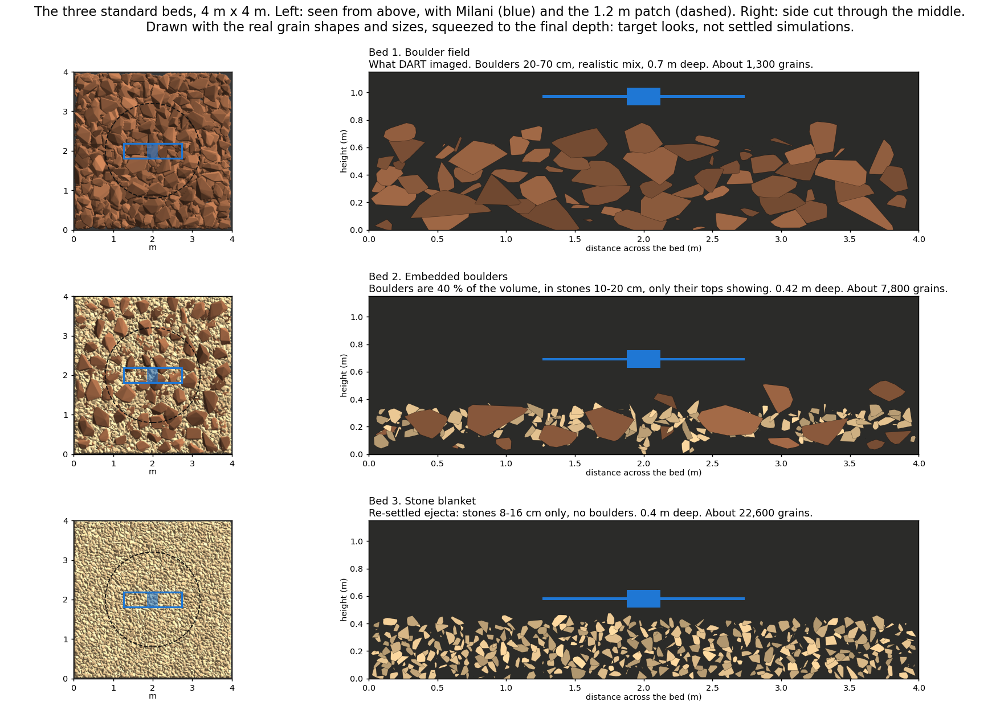

# The three beds

Every drop in the study lands on one of these three grounds, each 4 m x 4 m and
settled three times with different random pours (three seeds). Nobody has seen
Dimorphos's ground at the scale of the craft, so together they bracket what it may be.

*Target looks, drawn with the real grain shapes and sizes; not settled simulations.*

| bed | the idea | what it is | grains |
|---|---|---|---|
| **Bed 1: boulder field** | What DART imaged | [Boulders](../glossary.md#boulders) 20-70 cm long in the [realistic size mix](../glossary.md#realistic-size-mix), 0.7 m deep | about 1,300 |
| **Bed 2: embedded boulders** | Boulders sit in finer debris, tops just showing. A study of the DART impact infers boulders are at most about 40 % of the volume near the surface | Boulders are 40 % of the volume, in [small stones](../glossary.md#small-stones) 10-20 cm long, 0.42 m deep | about 7,800 |
| **Bed 3: stone blanket** | Debris from the impact has settled back over the surface | Small stones 8-16 cm long only, no boulders, 0.4 m deep | about 22,600 |

The real beds and their numbers follow, updated automatically as the lab Mac
reports. "Median move" is how far the median grain moved in the last second;
"small stones on top" is the share of the surface seen from above.

{{#include generated/beds.md}}
