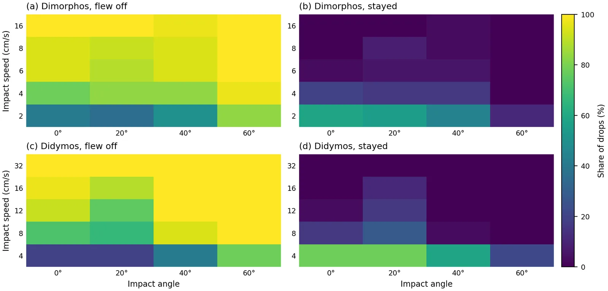
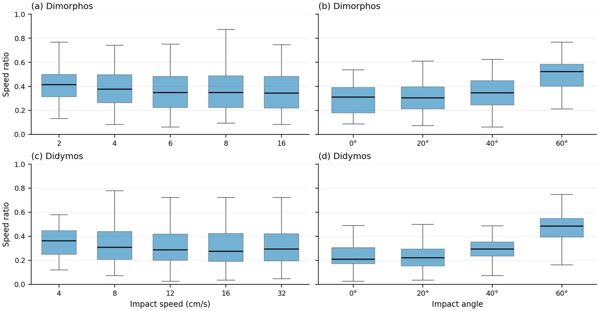
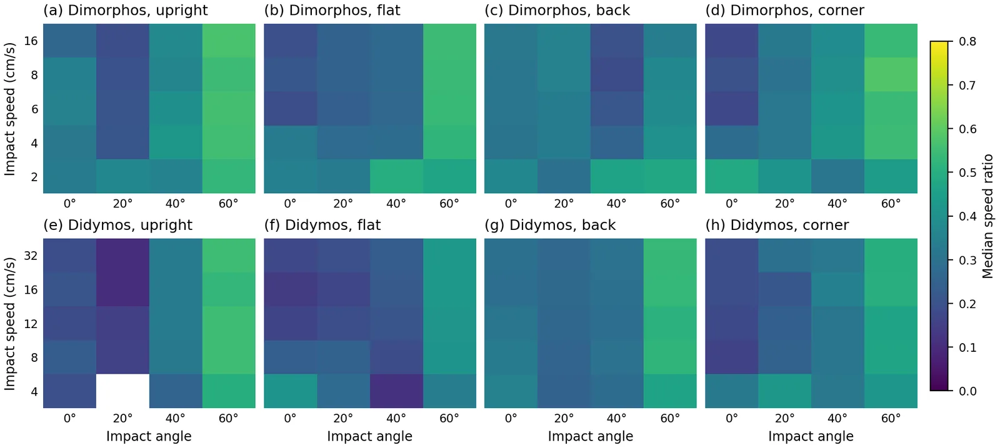
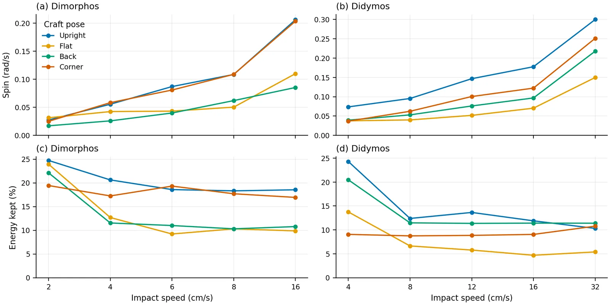
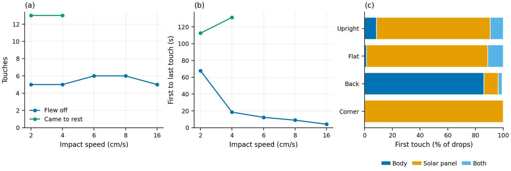
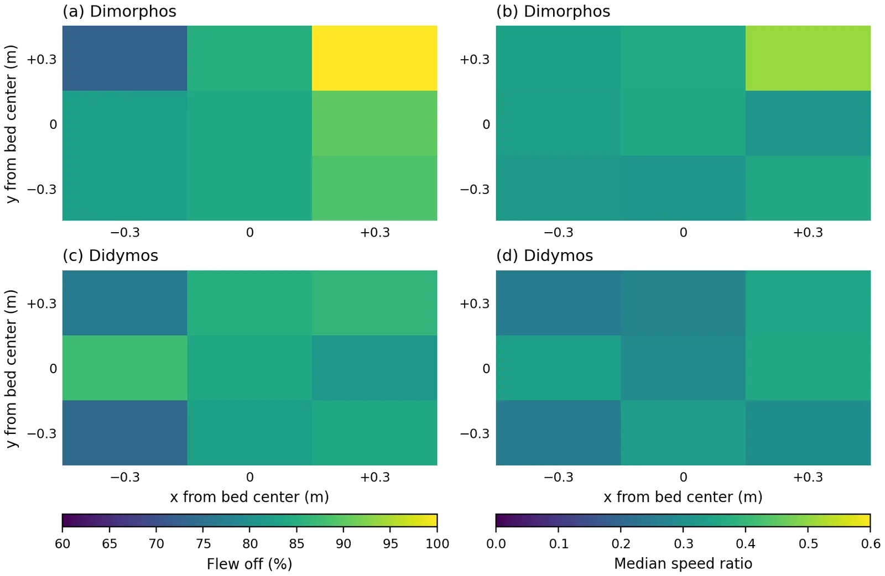
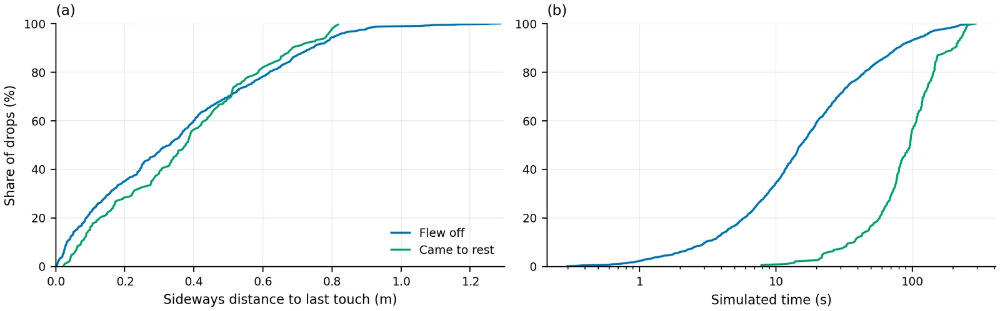
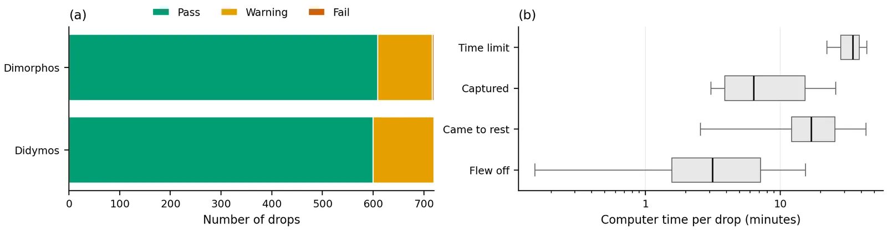
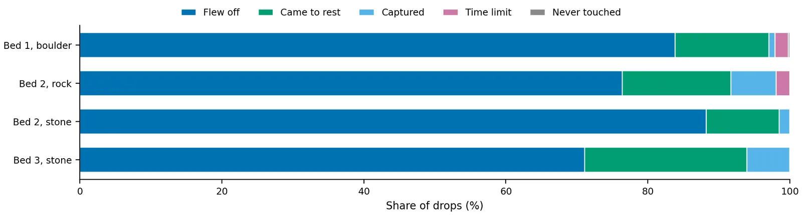

# Drop results

_Updated November 10, 2026, when the drops stopped. Nothing here needed a new simulation._

The drops stopped with 1,814 of the 4,360 planned drops finished. Bed 1 is complete, and beds 2 and 3 are barely started.

**Recommendation.** Keep bed 1 and replace beds 2 and 3 with one bed of stones 8–16 cm long, 30 cm thick, with a 1.0 m free patch. That is about 13 days of lab Mac time for 1,440 drops, against 42 days for beds 2 and 3 as planned. It still needs a short paired check before it is locked in, and the choice has not been made yet.

**Words used here.** The *speed ratio* is the speed leaving the surface divided by the impact speed. *Flew off* means the craft is in flight after its last touch on the patch. It includes the drops recorded as leaving the patch, which are in the air and differ only in whether they were rising as they crossed its edge. It does not mean the craft escaped. The *free patch* is the circle around the aim point where grains can move.

## How much is done

| Group | Done | Planned | Share | Where the drops are |
|---|---|---|---|---|
| Drop test | 40 | 40 | 100% | 5 test spots |
| Bed 1, both gravities | 1,440 | 1,440 | 100% | All 9 landing spots |
| Bed 2, Dimorphos | 107 | 720 | 15% | Center spot finished, 27 drops on the other 8 |
| Bed 2, Didymos | 144 | 720 | 20% | Center spot finished, 64 drops on the other 8 |
| Bed 3, Dimorphos | 48 | 720 | 7% | Center spot only, 48 of its 80 |
| Bed 3, Didymos | 35 | 720 | 5% | Center spot only, 35 of its 80 |
| **All** | **1,814** | **4,360** | **42%** | **About 10% of the planned computing** |

Bed 1 was cheap, so 42% of the drops is only about 1,600 of the roughly 15,200 core-hours planned. No drop failed. Beds 2 and 3 never reached the check of where the craft lands next.

## Bed 1 results

Boulders 20–70 cm long, 720 drops at each gravity: 5 speeds, 4 angles, 4 craft poses and 9 landing spots. Didymos has 4 times Dimorphos's gravity, so its speeds are twice as high to match.

- Most drops fly off: 85% on Dimorphos and 82% on Didymos. Another 11–15% come to rest.
- Impact speed decides whether the craft flies off. On Dimorphos 53% fly off at 2 cm/s and 99% at 16 cm/s.
- Impact angle decides how much speed it keeps: a median ratio of 0.25–0.32 up to 40° and 0.5 at 60°.
- Landing at 8 cm/s on Dimorphos, 1 drop in 144 leaves faster than 6.5 cm/s and 34% leave faster than 3.3 cm/s. At 16 cm/s those become 35% and 76%. Most drops that fly off stay on the body: 72% of those on Dimorphos, across all three beds, leave slower than 3.3 cm/s.
- Craft pose and landing spot matter much less. The solar panels touch first in over 80% of drops, except in the pose that lands on the back of the body.

<figure style="margin:1.4em 0">

<figcaption style="font-size:.9em;margin-top:.4em">How the drops ended, as a share of the drops at each impact speed (a, c; 144 drops per bar) and impact angle from vertical (b, d; 180 drops per bar), for Dimorphos (a, b) and Didymos (c, d) gravity. Flew off includes the drops recorded as leaving the free patch.</figcaption>
</figure>

<figure style="margin:1.4em 0">

<figcaption style="font-size:.9em;margin-top:.4em">Share of drops that flew off (a, c) and stayed, meaning came to rest or were captured (b, d), for each impact speed and angle. Top row Dimorphos, bottom row Didymos. Each cell is 36 drops.</figcaption>
</figure>

<figure style="margin:1.4em 0">

<figcaption style="font-size:.9em;margin-top:.4em">Share of the spread in the results explained by each setting taken alone (the between-group share of the variance): (a) whether the drop flew off; (b) the speed ratio of the drops that flew off.</figcaption>
</figure>

<figure style="margin:1.4em 0">

<figcaption style="font-size:.9em;margin-top:.4em">Speed ratio (speed leaving the surface divided by impact speed) of the drops that flew off, against impact speed (a, c) and impact angle (b, d). Boxes span the middle half of the drops, the line is the median and the whiskers reach 1.5 times the box height.</figcaption>
</figure>

<figure style="margin:1.4em 0">

<figcaption style="font-size:.9em;margin-top:.4em">Median speed ratio of the drops that flew off, for each impact speed, angle and craft pose. Top row Dimorphos, bottom row Didymos. Each cell holds at most 9 drops; white cells had none that flew off.</figcaption>
</figure>

<figure style="margin:1.4em 0">

<figcaption style="font-size:.9em;margin-top:.4em">Speed leaving the surface of every drop that flew off, against impact speed, for Dimorphos (a) and Didymos (b). The gray band in (a) is the speed needed to escape Dimorphos from near its surface, 3.3 to 6.5 cm/s. (c) Share of Dimorphos drops leaving faster than the lower and upper edge of that band.</figcaption>
</figure>

<figure style="margin:1.4em 0">

<figcaption style="font-size:.9em;margin-top:.4em">Which way the craft leaves, both gravities, drops that flew off. (a) Height of the exit path above the horizontal against impact angle; the line in each shape is the median. (b) Direction relative to the approach: 0° carries on forward and ±180° comes back.</figcaption>
</figure>

<figure style="margin:1.4em 0">

<figcaption style="font-size:.9em;margin-top:.4em">Median spin leaving the surface (a, b) and share of the mechanical energy kept (c, d) against impact speed, one line per craft pose, for the drops that flew off.</figcaption>
</figure>

<figure style="margin:1.4em 0">

<figcaption style="font-size:.9em;margin-top:.4em">How the craft meets the ground. Median number of separate touches (a) and seconds from first to last touch (b) against impact speed on Dimorphos, one line per outcome; a point needs at least 5 drops. (c) Which part of the craft touched first, for each pose, both gravities.</figcaption>
</figure>

<figure style="margin:1.4em 0">

<figcaption style="font-size:.9em;margin-top:.4em">The nine landing spots, 0.3 m apart, laid out as on the bed, 80 drops each. Share of drops that flew off (a, c) and median speed ratio of those drops (b, d). Top row Dimorphos, bottom row Didymos.</figcaption>
</figure>

<figure style="margin:1.4em 0">

<figcaption style="font-size:.9em;margin-top:.4em">The same drops at both gravities, with Didymos at twice Dimorphos's speed so that the two match in scaled terms. Each gravity uses its own pour of the bed. (a) Speed ratio of the pairs that flew off both times, with the line of equal values. (b) Number of pairs with each combination of outcomes.</figcaption>
</figure>

<figure style="margin:1.4em 0">

<figcaption style="font-size:.9em;margin-top:.4em">Share of drops at or below (a) the sideways distance from the aim point to the craft's last touch and (b) the simulated time to the end of the drop, one curve per outcome, both gravities.</figcaption>
</figure>

<figure style="margin:1.4em 0">

<figcaption style="font-size:.9em;margin-top:.4em">(a) Result of each drop's quality check. (b) Computer time per drop on one core, by outcome: boxes span the middle half, the line is the median and the whiskers reach 1.5 times the box width.</figcaption>
</figure>

## How big the beds need to be

A drop only simulates the free patch and a thin frozen ring around it. Time per drop follows the number of grains in the patch: it grows as grains to the power 1.52, so halving the grains makes each step 2.9 times faster.

<figure style="margin:1.4em 0">

<figcaption style="font-size:.9em;margin-top:.4em">Computer time per step against the number of grains simulated, for every production drop of more than 500 steps. The dashed line is a power-law fit.</figcaption>
</figure>

**Footprint (now 4 m × 4 m): no effect on drop time.** The bed outside the patch is left out of the drop. The footprint only affects settling, which takes 1.4 hours for stones, and the check of where a craft lands next.

**Patch radius (now 1.2 m): down to 1.0 m, not much further.** The open craft reaches 0.76 m from its center to the tip of a solar panel, so the patch has little room. On stones the disturbance dies away near 1 m. Replaying every recorded flight path against smaller circles gives this:

| Patch radius | Bed 1 drops cut short | Bed 2 | Bed 3 | Time per drop, stones |
|---|---|---|---|---|
| 1.2 m (today) | 0% | 0% | 0% | 1.00 |
| 1.1 m | 2.7% | 2.4% | 2.4% | 0.78 |
| **1.0 m** | **7.2%** | **5.2%** | **7.2%** | **0.60** |
| 0.9 m | 11.6% | 6.8% | 8.4% | 0.45 |
| 0.8 m | 17.0% | 11.6% | 8.4% | 0.33 |

Cut short means the run would have stopped at the patch edge before its real end. At 1.0 m, 104 of the 1,437 bed 1 drops would be cut, and 19 of those leave faster than 5 cm/s.

<figure style="margin:1.4em 0">

<figcaption style="font-size:.9em;margin-top:.4em">(a) Share of drops that a smaller free patch would cut short, from replaying each recorded path against a smaller circle, in addition to those that already leave today's 1.2 m patch. (b) Time per drop on the stone bed relative to today, from the fitted cost, for three thicknesses of stones.</figcaption>
</figure>

**Thickness (now 37 cm on stones): about 30 cm.** The craft itself barely goes in: from its first touch to its lowest touch it travels a median of 3 cm and at most 10 cm on stones. The stones go deeper. In the median drop, 95% of the stones that moved at least 5 mm lie within 28 cm of the surface, and 33 cm in the deepest tenth of drops. Stones moving at least 2 cm reach 19 cm and 28 cm. At 25 cm the floor would replace a layer where about 1 stone in 10 still moves. At 30 cm it replaces the layer where about 1 in 30 does, as it does in today's bed.

<figure style="margin:1.4em 0">

<figcaption style="font-size:.9em;margin-top:.4em">Share of the grains in each 20 cm ring around the aim point (a) and each 10 cm layer below the mean surface (b) that moved at least 5 mm during a drop. Each point is the median over all drops on that bed, 1,771 drops in all. Grains whose centers sit above the mean surface are left out of (b).</figcaption>
</figure>

<figure style="margin:1.4em 0">

<figcaption style="font-size:.9em;margin-top:.4em">Share of drops at or below a given depth, measured from the craft's first touch to the lowest point it touched. The beds are 67 cm (bed 1), 41 cm (bed 2) and 37 cm (bed 3) thick.</figcaption>
</figure>

**What each choice costs.**

| Choice | Grains in a drop | Hours per drop | Days for 1,440 drops, 15 cores |
|---|---|---|---|
| Beds 2 and 3 as planned (2,880 drops) | 2,600 and 4,100 | 3.0 and 7.4 | 42 |
| Stones only, today's size | 4,100 | 7.4 | 30 |
| Stones, 37 cm thick, 1.0 m patch | 2,900 | 4.5 | 18 |
| **Stones, 30 cm thick, 1.0 m patch** | **2,360** | **3.2** | **13** |
| Stones, 25 cm thick, 1.0 m patch | 1,970 | 2.5 | 10 |

Going finer is expensive. Stones 25% smaller would mean 2.4 times the grains and about 3.7 times the time, so 8–16 cm stays the finest these machines can afford for this many drops.

## Combining beds 2 and 3

The data supports dropping bed 2. Under the same conditions at the center spot, the differences between beds are about the size of the differences between two spots on one bed.

| Comparison, same drops | Same outcome | Change in speed ratio (median) |
|---|---|---|
| Bed 1 against bed 2 | 83% | 0.11 |
| Bed 2 against bed 3 | 80% | 0.07 |
| Bed 1 against bed 3 | 84% | 0.09 |
| Two spots on bed 1, for reference | 82–85% | 0.09–0.14 |

<figure style="margin:1.4em 0">

<figcaption style="font-size:.9em;margin-top:.4em">The three beds under the same conditions, at the center landing spot. (a) How the drops ended. (b) Speed ratio of the drops that flew off; the line in each shape is the median.</figcaption>
</figure>

Dropping bed 2 does lose something. It is not a plain mix of the other two: a drop that hits a rock first flies off less often than on bare boulders (76% against 84%), and one that hits a stone first flies off more often than on the stone bed (88% against 71%). The paper could only bracket that case between the two remaining beds.

<figure style="margin:1.4em 0">

<figcaption style="font-size:.9em;margin-top:.4em">How the drops ended, grouped by what the craft touched first: bed 1 on boulders, bed 2 on a rock or on a stone, bed 3 on stones.</figcaption>
</figure>

## What is still unknown

- **Whether 30 cm of stones behaves like 37 cm.** Knowing where stones move does not show whether the craft notices. The depth test so far was on bed 1 only. About 20 paired drops on a thinner stone bed would settle it.
- **How much of the bed comparison is the bed.** Beds 2 and 3 are nearly all at the center spot, and one spot says little about a whole bed.
- **The drop times.** The cost table assumes the time per drop follows the fit, measured between 390 and 4,100 grains. The choices above all fall inside that range.

{{#include generated/results.md}}
