# Drop results

_Updated November 10, 2026, when the drops stopped. Nothing here needed a new simulation._

The drops stopped with 1,814 of the 4,360 planned drops finished. Bed 1 is complete, and beds 2 and 3 are barely started.

**Decided November 10: bed 2 stops and bed 3 continues as it is,** 37 cm of stones, now with a 1.0 m free patch (bed 1 used 1.2 m). Its 1,440 drops take about 18 days on the lab Mac. The 83 bed 3 drops made with the 1.2 m patch are kept, and pair with the new ones at the center spot as a check of the smaller patch. Bed 2's 251 drops stay in the record.

**Symbols and words used here.** vin is the impact speed, vout the speed leaving the surface, and vout/vin their ratio. θin is the impact angle from vertical, ωout the craft's spin as it leaves, and Fr = vin/√(gL) the Froude number (g the gravity, L the craft's 36.6 cm length). *Flew off* means the craft is in flight after its last touch on the patch. It includes the drops recorded as leaving the patch, which are in the air and differ only in whether they were rising as they crossed its edge. It does not mean the craft escaped. The *free patch* is the circle around the aim point where grains can move.

## How much is done

| Group | Done | Planned | Share | Where the drops are |
|---|---|---|---|---|
| Drop test | 40 | 40 | 100% | 5 test spots |
| Bed 1, both gravities | 1,440 | 1,440 | 100% | All 9 landing spots |
| Bed 2, Dimorphos | 107 | 720 | 15% | Center spot finished, 27 drops on the other 8 |
| Bed 2, Didymos | 144 | 720 | 20% | Center spot finished, 64 drops on the other 8 |
| Bed 3, Dimorphos | 48 | 720 | 7% | Center spot only, 48 of its 80 |
| Bed 3, Didymos | 35 | 720 | 5% | Center spot only, 35 of its 80 |
| **All** | **1,814** | **4,360** | **42%** | **About 10% of the planned computing** |

Bed 1 was cheap, so 42% of the drops is only about 1,600 of the roughly 15,200 core-hours planned. No drop failed. Beds 2 and 3 never reached the check of where the craft lands next.

## Bed 1 results

Boulders 20–70 cm long, 720 drops at each gravity: 5 speeds, 4 angles, 4 craft poses and 9 landing spots. Didymos has 4 times Dimorphos's gravity, so its speeds are twice as high to match.

- Most drops fly off: 85% on Dimorphos and 82% on Didymos. Another 11–15% come to rest.
- Impact speed decides whether the craft flies off. On Dimorphos 53% fly off at 2 cm/s and 99% at 16 cm/s.
- Impact angle decides how much speed it keeps: a median vout/vin of 0.25–0.32 up to 40° and 0.5 at 60°.
- Landing at 8 cm/s on Dimorphos, 1 drop in 144 leaves faster than 6.5 cm/s and 34% leave faster than 3.3 cm/s. At 16 cm/s those become 35% and 76%. Most drops that fly off stay on the body: 72% of those on Dimorphos, across all three beds, leave slower than 3.3 cm/s.
- Craft pose and landing spot matter much less. The solar panels touch first in over 80% of drops, except in the pose that lands on the back of the body.

<figure style="margin:1.4em 0">
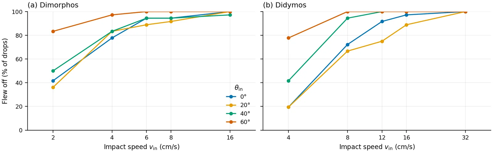
<figcaption style="font-size:.9em;margin-top:.4em">Share of drops that flew off against impact speed vin, one line per impact angle θin from vertical, for Dimorphos (a) and Didymos (b) gravity. Each point is 36 drops: 9 landing spots and 4 craft poses. The other drops came to rest or were captured; a few reached the 300 s time limit or never touched. Flew off includes the drops recorded as leaving the free patch.</figcaption>
</figure>

<figure style="margin:1.4em 0">
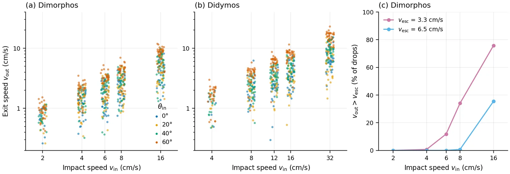
<figcaption style="font-size:.9em;margin-top:.4em">Speed leaving the surface vout against impact speed vin for every drop that flew off, colored by impact angle θin, for Dimorphos (a) and Didymos (b) gravity; impact speeds are spread a little sideways so the points do not overlap. (c) Share of the Dimorphos drops leaving faster than the escape speed vesc from near Dimorphos's surface, which ranges from 3.3 to 6.5 cm/s over the surface; each point is 144 drops.</figcaption>
</figure>

<figure style="margin:1.4em 0">
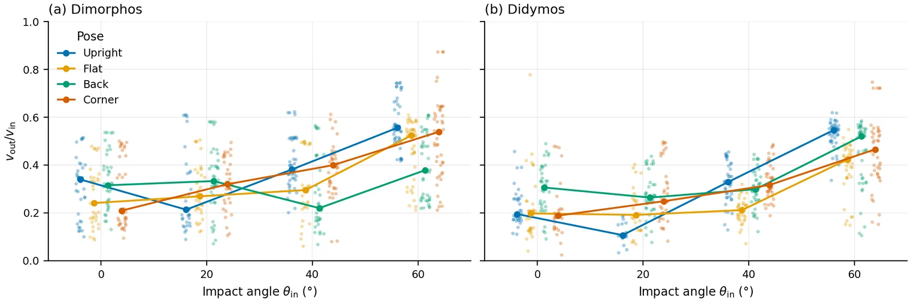
<figcaption style="font-size:.9em;margin-top:.4em">Speed leaving the surface over impact speed, vout/vin, for every drop that flew off, against impact angle θin from vertical, for Dimorphos (a) and Didymos (b) gravity. Points are colored by craft pose and shifted a little sideways by pose; lines join each pose's medians. All impact speeds together: impact speed explains under 2 % of the variance of vout/vin (see the next figure).</figcaption>
</figure>

<figure style="margin:1.4em 0">
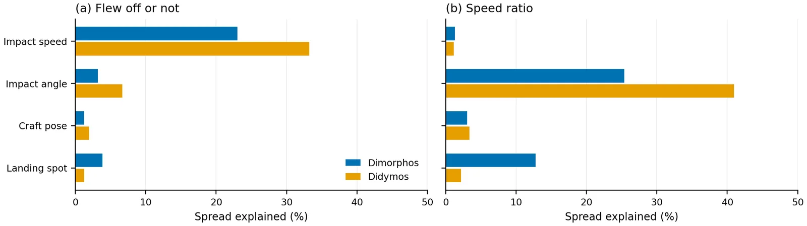
<figcaption style="font-size:.9em;margin-top:.4em">Share of the variance of each result explained by each setting on its own (η², the between-group share of the variance): (a) whether a drop flew off, counted as 1 or 0; (b) vout/vin of the drops that flew off. Settings: impact speed vin, impact angle θin, craft pose and landing spot.</figcaption>
</figure>

<figure style="margin:1.4em 0">
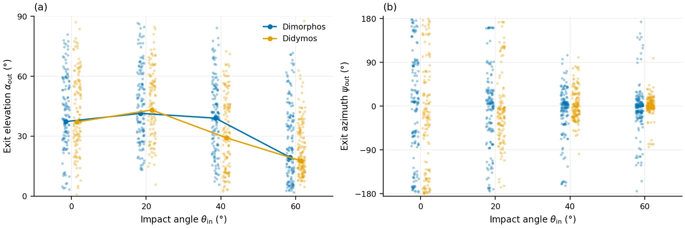
<figcaption style="font-size:.9em;margin-top:.4em">Direction of the exit velocity for every drop that flew off, against impact angle θin, Dimorphos and Didymos gravity shifted a little sideways. (a) Elevation αout above the local horizontal; lines join the medians. (b) Azimuth ψout from the incoming horizontal direction: 0° carries on forward, ±180° comes back. Straight-down drops (θin = 0°) have no incoming horizontal direction, so their ψout is measured from the bed's x axis.</figcaption>
</figure>

<figure style="margin:1.4em 0">
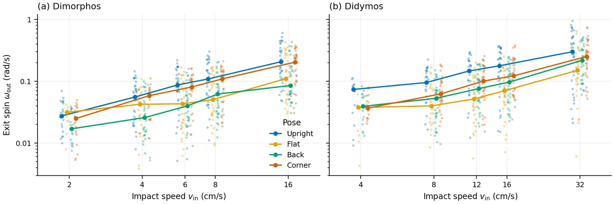
<figcaption style="font-size:.9em;margin-top:.4em">Spin leaving the surface ωout (magnitude of the craft's angular velocity) against impact speed vin for every drop that flew off, for Dimorphos (a) and Didymos (b) gravity. Points are colored by craft pose and shifted a little sideways by pose; lines join each pose's medians.</figcaption>
</figure>

<figure style="margin:1.4em 0">
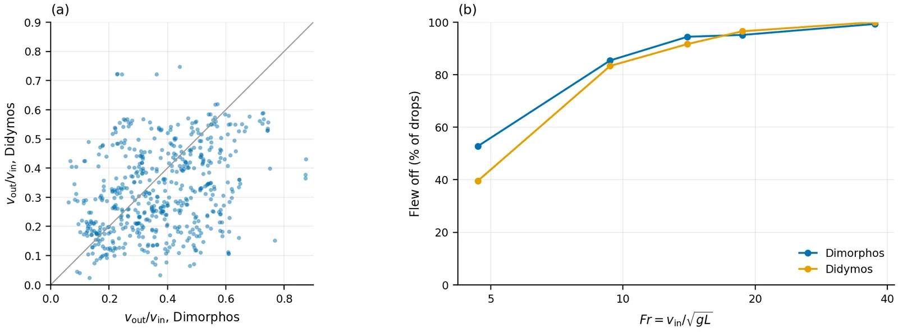
<figcaption style="font-size:.9em;margin-top:.4em">The same drops at both gravities, with Didymos at twice Dimorphos's speed so that the Froude number Fr = vin/√(gL) matches (g the gravity, L = 36.6 cm the craft's length). Each gravity uses its own pour of the bed. (a) vout/vin of the pairs that flew off both times; the line marks equal values. (b) Share of drops that flew off against Fr; each point is 144 drops.</figcaption>
</figure>

## How big the beds need to be

A drop only simulates the free patch and a thin frozen ring around it. Time per drop follows the number of grains in the patch: it grows as grains to the power 1.52, so halving the grains makes each step 2.9 times faster.

<figure style="margin:1.4em 0">
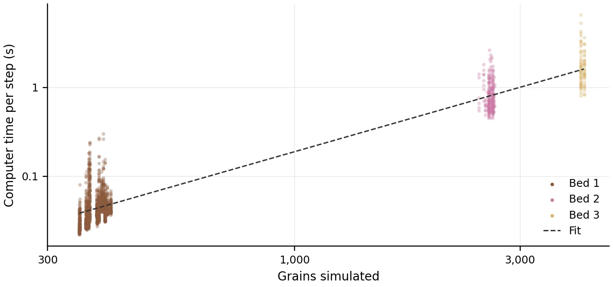
<figcaption style="font-size:.9em;margin-top:.4em">Wall time per time step on one core against the number of grains simulated N, for every production drop of more than 500 steps; the line is the power-law fit, given in the legend.</figcaption>
</figure>

**Footprint (now 4 m × 4 m): no effect on drop time.** The bed outside the patch is left out of the drop. The footprint only affects settling, which takes 1.4 hours for stones, and the check of where a craft lands next.

**Patch radius (now 1.2 m): down to 1.0 m, not much further.** The open craft reaches 0.76 m from its center to the tip of a solar panel, so the patch has little room. On stones the disturbance dies away near 1 m. Replaying every recorded flight path against smaller circles gives this:

| Patch radius | Bed 1 drops cut short | Bed 2 | Bed 3 | Time per drop, stones |
|---|---|---|---|---|
| 1.2 m (today) | 0% | 0% | 0% | 1.00 |
| 1.1 m | 2.7% | 2.4% | 2.4% | 0.78 |
| **1.0 m** | **7.2%** | **5.2%** | **7.2%** | **0.60** |
| 0.9 m | 11.6% | 6.8% | 8.4% | 0.45 |
| 0.8 m | 17.0% | 11.6% | 8.4% | 0.33 |

Cut short means the run would have stopped at the patch edge before its real end. At 1.0 m, 104 of the 1,437 bed 1 drops would be cut, and 19 of those leave faster than 5 cm/s.

<figure style="margin:1.4em 0">
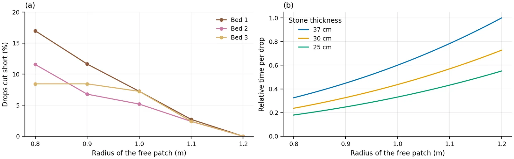
<figcaption style="font-size:.9em;margin-top:.4em">(a) Share of drops that a free patch of radius R would cut short, from replaying each recorded path against a smaller circle, in addition to those that already leave the 1.2 m patch. (b) Time per drop t on the stone bed relative to tref, the time with R = 1.2 m and 37 cm of stones, from the fitted cost law, for three stone thicknesses.</figcaption>
</figure>

**Thickness (now 37 cm on stones): about 30 cm.** The craft itself barely goes in: from its first touch to its lowest touch it travels a median of 3 cm and at most 10 cm on stones. The stones go deeper. In the median drop, 95% of the stones that moved at least 5 mm lie within 28 cm of the surface, and 33 cm in the deepest tenth of drops. Stones moving at least 2 cm reach 19 cm and 28 cm. At 25 cm the floor would replace a layer where about 1 stone in 10 still moves. At 30 cm it replaces the layer where about 1 in 30 does, as it does in today's bed.

<figure style="margin:1.4em 0">
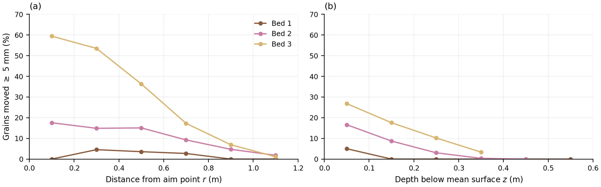
<figcaption style="font-size:.9em;margin-top:.4em">Share of the grains that moved at least 5 mm during a drop, in each 20 cm ring around the aim point (a, r the distance from the aim point) and each 10 cm layer below the mean surface (b, z the depth). Each point is the median over all drops on that bed, 1,771 drops in all. Grains whose centers sit above the mean surface are left out of (b).</figcaption>
</figure>

<figure style="margin:1.4em 0">
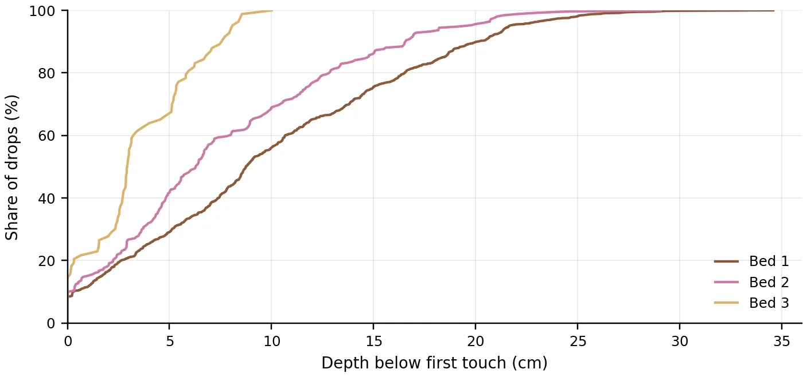
<figcaption style="font-size:.9em;margin-top:.4em">Cumulative share of drops against how far the craft sank: the depth from its first touch to the lowest point it touched. The beds are 67 cm (bed 1), 41 cm (bed 2) and 37 cm (bed 3) thick.</figcaption>
</figure>

**What each choice costs.**

| Choice | Grains in a drop | Hours per drop | Days for 1,440 drops, 15 cores |
|---|---|---|---|
| Beds 2 and 3 as planned (2,880 drops) | 2,600 and 4,100 | 3.0 and 7.4 | 42 |
| Stones only, today's size | 4,100 | 7.4 | 30 |
| Stones, 37 cm thick, 1.0 m patch | 2,900 | 4.5 | 18 |
| **Stones, 30 cm thick, 1.0 m patch** | **2,360** | **3.2** | **13** |
| Stones, 25 cm thick, 1.0 m patch | 1,970 | 2.5 | 10 |

Going finer is expensive. Stones 25% smaller would mean 2.4 times the grains and about 3.7 times the time, so 8–16 cm stays the finest these machines can afford for this many drops.

## Combining beds 2 and 3

Bed 2 was stopped on November 10. Under the same conditions at the center spot, the differences between beds are about the size of the differences between two spots on one bed.

| Comparison, same drops | Same outcome | Median change in vout/vin |
|---|---|---|
| Bed 1 against bed 2 | 83% | 0.11 |
| Bed 2 against bed 3 | 80% | 0.07 |
| Bed 1 against bed 3 | 84% | 0.09 |
| Two spots on bed 1, for reference | 82–85% | 0.09–0.14 |

<figure style="margin:1.4em 0">
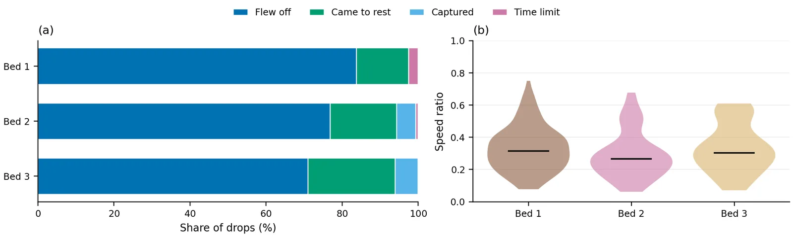
<figcaption style="font-size:.9em;margin-top:.4em">The three beds under the same conditions, at the center landing spot, both gravities together. (a) Share of drops that flew off against the Froude number Fr = vin/√(gL) (g the gravity, L = 36.6 cm the craft's length), which puts the two gravities on one scale; each point is up to 32 drops. (b) vout/vin of the drops that flew off against impact angle θin; points shifted a little sideways by bed, lines join each bed's medians.</figcaption>
</figure>

Dropping bed 2 does lose something. It is not a plain mix of the other two: a drop that hits a rock first flies off less often than on bare boulders (76% against 84%), and one that hits a stone first flies off more often than on the stone bed (88% against 71%). The paper could only bracket that case between the two remaining beds.

## What is still unknown

- **Whether 30 cm of stones behaves like 37 cm.** Knowing where stones move does not show whether the craft notices. The depth test so far was on bed 1 only. About 20 paired drops on a thinner stone bed would settle it.
- **How much of the bed comparison is the bed.** Beds 2 and 3 are nearly all at the center spot, and one spot says little about a whole bed.
- **The drop times.** The cost table assumes the time per drop follows the fit, measured between 390 and 4,100 grains. The choices above all fall inside that range.

{{#include generated/results.md}}
